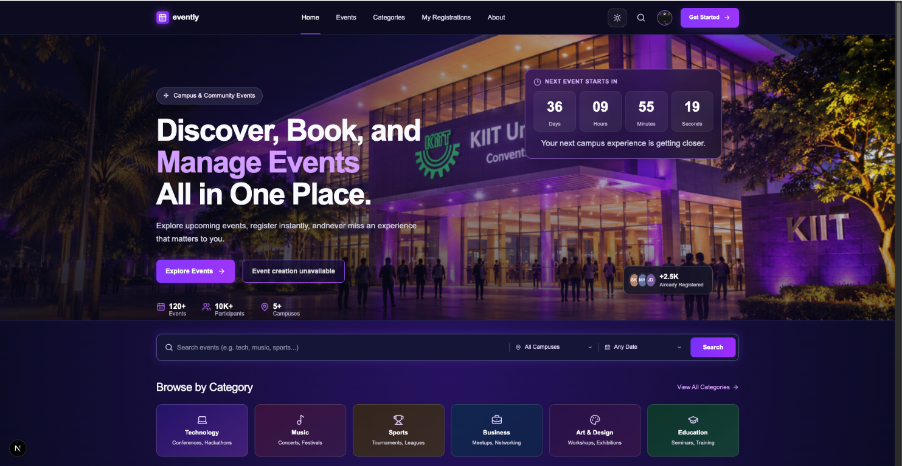
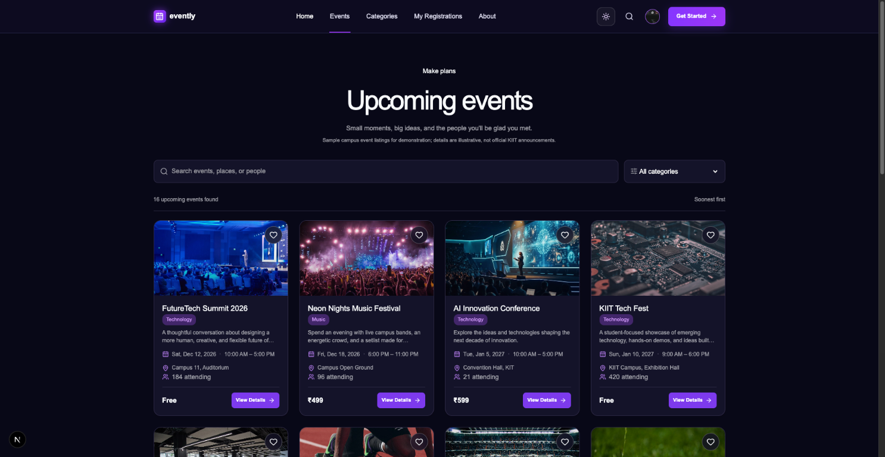
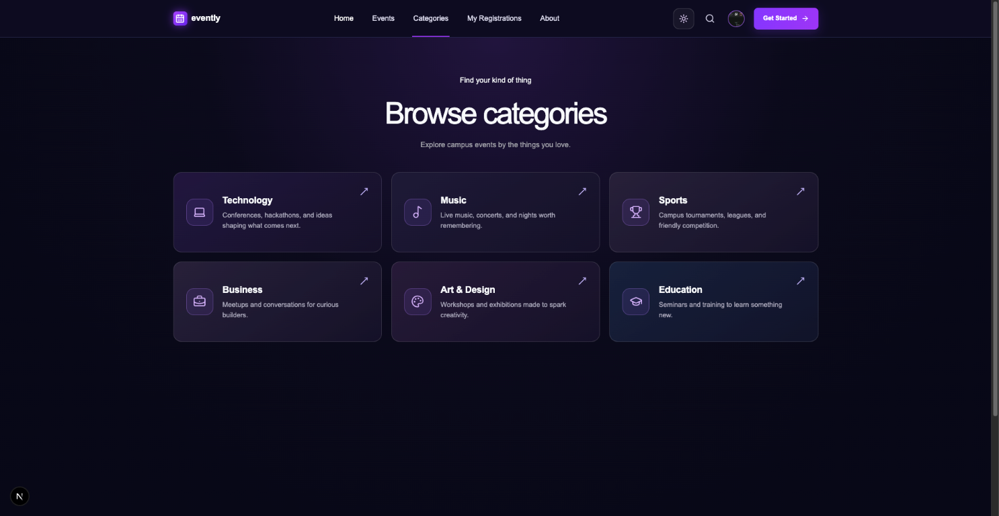
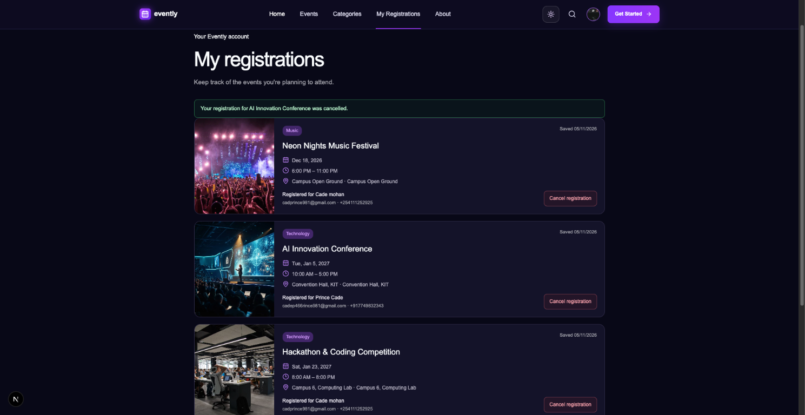

# Evently

Evently is a university event discovery and registration website for the K Explore Web Designing assignment. It helps students browse campus events, filter by category, review event information, reserve a place, and manage registrations. Evently uses a dark navy and purple design with an optional light theme.

> **Demonstration data:** Event listings, dates, venues, and attendee totals are illustrative sample content. They are not official KIIT event announcements.

## Live Demo

[Visit Evently](https://evently-orpin-chi.vercel.app/)

## Project Links

- 🌐 **Live Website:** [Visit Evently](https://evently-orpin-chi.vercel.app/)
- 💻 **Source Code:** [GitHub Repository](https://github.com/Mohan-77/Evently)
- 👨‍💻 **Developer:** [Mohan-77](https://github.com/Mohan-77)

## Features

- Responsive homepage with search, campus and date filters, category browsing, and event discovery
- Searchable, filterable upcoming event listing and dedicated category page
- Event details with description, image, date, time, venue, category, host, price, and attendee count
- Registration form with name, email, phone, selected event, and client-side validation
- Registration confirmation, duplicate-registration prevention, and cancellation
- Favorites and registrations persisted in browser Local Storage
- Browser-local profile details, registered event summaries, and saved favorites
- Dark and light themes with saved preference
- Live countdown to the nearest upcoming event, plus in-progress and ended states
- Keyboard-friendly controls, reduced-motion support, and responsive layouts

## Bonus challenges

- **Dark/light mode:** switch themes from the navbar; the selected theme is saved in this browser.
- **Event countdown:** the homepage counts down to the nearest upcoming event, updates every second, and handles in-progress or empty schedules.
- **Animations:** subtle card, button, and navigation transitions; reduced-motion preferences are respected.
- **Local Storage management:** registrations, cancellations, favorites, and profile details persist in this browser. Theme preference is persisted by `next-themes`.

## Technology

- Next.js App Router and React
- TypeScript
- Tailwind CSS and project CSS
- `next-themes` for theme persistence and flash prevention
- Lucide React icons

## Routes

- `/` — Homepage, event search, categories, and event discovery
- `/events` — Searchable and filterable upcoming events
- `/categories` — Browse event categories
- `/events/[id]` — Event details and reservation link
- `/registrations` — Register for an event
- `/registrations?view=mine` — View or cancel registrations saved in this browser
- `/profile` — Edit browser-local contact details and review registrations and favorites
- `/about` — About Evently

## Screenshots

### Homepage



### Events



### Categories



### Registration



## Installation

Use Node.js compatible with the Next.js version in `package.json`.

```bash
npm install
```

## Development instructions

Start the local development server with:

```bash
npm run dev
```

Open [http://localhost:3000](http://localhost:3000).

## Quality checks

```bash
npm run lint
npm run build
```

## Local Storage limitations

Registrations, favorites, and theme preference are stored in the visitor's browser. They remain available in that browser after refresh, but are not synced across browsers or devices and are not sent to a server. Clearing browser storage removes them. This implementation is for an assignment demonstration; a backend and privacy notice are needed before collecting real participant information.

## Deployment

Push the Evently project repository to a Git provider and import it into a Next.js-compatible host such as Vercel. Use the standard install and build commands above. The current project requires no environment variables or backend service.
